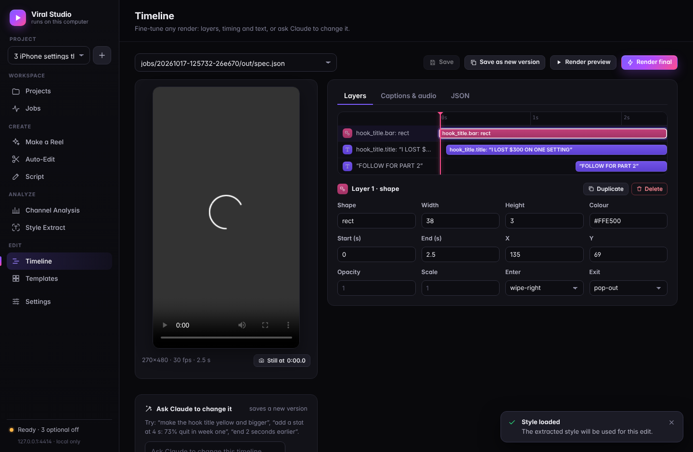
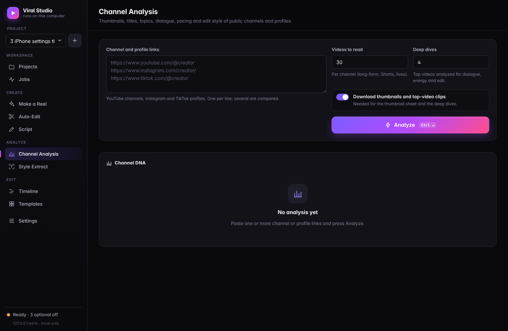
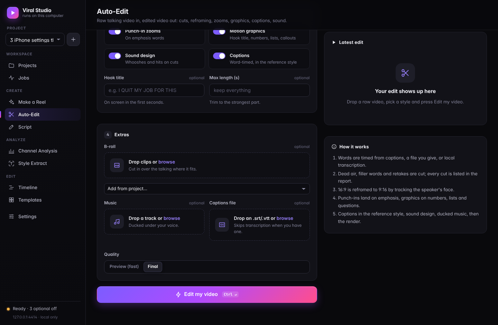
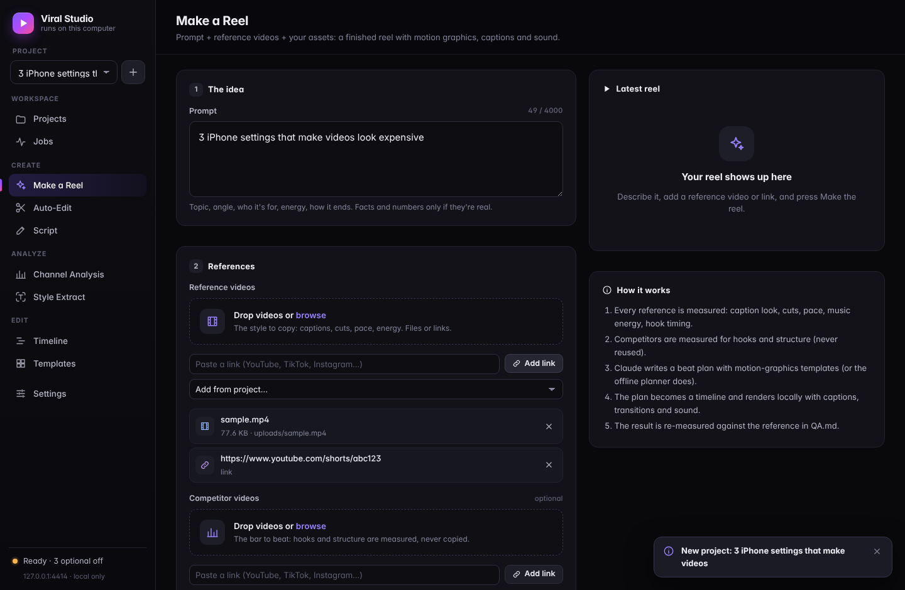

# Viral Hyper Agent

**A social media team for one person: research, scripts, motion graphics,
editing and posting. It runs on your own computer and your Claude
subscription.**

Give it your niche, a reference video you like, your competitors' videos or
your own raw footage. It finds what's trending, measures exactly how the best
videos are made, writes scripts that sound like you, makes the reel with
motion graphics, edits your footage like a short-form editor, writes the posts
and schedules what you approve.

There are two ways to use it:

| | what it is | start it |
| --- | --- | --- |
| **Viral Studio** | a local web app: make reels, auto-edit, analyze channels, extract styles, edit timelines, "Ask Claude" to change a video | `studio.bat` (Windows) or `./studio.sh`, then http://127.0.0.1:4320 |
| **The agent** | Claude Code with 9 agents and 46 skills: research, scripts, strategy, posting, and it drives the studio for you | open Claude Code in this folder: `make me go viral` |

Rendering happens on your machine (ffmpeg + Python). Planning and writing use
your Claude subscription through Claude Code. There's no cloud render bill and
no API key to set up.

## What it can do

### Make a reel from a prompt and reference videos
`python -m vstudio reel --prompt "..." --ref <video you like> --competitor <video to beat> --asset <your clips>`

1. **Analyzes** every input. For each reference it measures the caption font
   look, size, position, colours, words per card, speaking pace, hook timing,
   cut rate and palette. For each competitor it notes the hook and structure.
2. **Writes `BRIEF.md`**: style targets and what to beat.
3. **Plans the beats**: Claude plans with the motion-graphics catalog; an
   offline planner works without Claude.
4. **Renders** with captions, transitions, camera moves, sound effects and
   ducked music.
5. **QA-checks** the output against the reference's numbers (`QA.md`, plus a
   contact sheet).

### Edit your raw footage like a pro editor
`python -m vstudio autoedit raw.mp4 --aspect 9:16 --style <style_dna.json> --render`

- **Cleans the take:** cuts dead air, filler words ("um") and retakes.
- **Reframes** 16:9 to 9:16 by tracking your face.
- **Adds motion:** alternating punch-ins on jump cuts and emphasis zooms on
  numbers and key words.
- **Adds graphics:** a hook title, plus callouts that match what you say
  (stats, list items, questions, versus) placed away from your face.
- **Captions** in any extracted viral style.
- **B-roll** cutaways from a folder, matched by file name.
- **Sound:** sound effects, ducked music, about -14 LUFS loudness, a progress
  bar.
- **Reports** every cut and the reason for it in `EDIT_REPORT.md`.

### Reverse-engineer any channel
`python -m vstudio channel https://www.youtube.com/@creator --deep 4`

- **Inventory:** every long-form video, Short and live.
- **Performance:** each video's views against the channel's usual (the
  outlier multiple) and views per day.
- **Habits:** upload cadence, a topic tag on every video, and title patterns.
- **Thumbnails:** text, faces, colours and layout, with a contact sheet.
- **Deep dive into the top videos:** speaking pace, word spacing, hooks,
  re-hooks, an energy score, content type, caption style and edit rhythm.
- **Playbook:** how to compete with or copy the channel. Several links give a
  side-by-side comparison.

### Find trends, write human scripts, post
`/trend-hunt`, `/script-forge`, `/viral-extract` and `/publish`, unchanged
from v2. Details are in [What's inside](#whats-inside).

| | |
| --- | --- |
|  |  |
|  |  |

## The motion-graphics library

46 templates in 9 groups. Every one scales to 9:16, 1:1, 4:5 and 16:9 and
keeps to the platform safe zones:

| group | templates |
| --- | --- |
| hooks | hook_title, title_card, chapter_marker, question, alert_banner |
| text | kinetic_text, emphasis_word, word_stack, underline_reveal, quote |
| numbers | stat, counter_reveal, percent_ring, bar_chart, rating, price_tag, countdown, big_number_bg |
| lists | list_item, checklist, ranking, timeline_steps, step_number, pros_cons |
| compare | versus, before_after, split_screen, myth_vs_fact |
| social | comment_bubble, post_card, notification_pop, text_message, search_bar, poll, like_burst |
| pointers | highlight_box, arrow, callout, icon_badge |
| cta | cta, subscribe |
| utility | progress_bar, lower_third, source_card, location_tag, image_card |

The engine also has:
- **Entrances and exits:** 21 entrance and 14 exit animations (pop, stamp,
  whip with motion blur, glitch, typewriter, word-by-word, wipes...).
- **Easing:** 19 easing curves.
- **Effects:** flash, shake, glitch, zoom blur, vignette, colour grade, grain
  and letterbox.
- **Camera:** punch-ins and drift.
- **Sound effects:** 12 (whoosh, pop, hit, riser, ding...), synthesized on
  your machine so they are royalty-free.

Preview any template with `python -m vstudio templates preview stat --out stat.mp4`.

## Install

You need Python 3.10+, Git, **FFmpeg 5 or newer** and
[Claude Code](https://code.claude.com) (logged in).

**Windows (PowerShell):**
```powershell
git clone https://github.com/sanjayhatwa/Claude-AI-.git D:\viral-hyper-agent
cd D:\viral-hyper-agent
.\setup.ps1
```
FFmpeg: `winget install Gyan.FFmpeg`. Then double-click `studio.bat`.

**macOS / Linux:**
```bash
git clone https://github.com/sanjayhatwa/Claude-AI-.git viral-hyper-agent && cd viral-hyper-agent
./setup.sh          # FFmpeg: brew install ffmpeg  /  sudo apt install ffmpeg
./studio.sh
```

Setup installs the Python packages and downloads free caption fonts
(Montserrat, Anton, Bebas Neue, Poppins... all OFL) and the face-tracking
model. It also fetches the full ReelMimic, Harvey, gstack and REA repos into
`tools/`. Check everything with:

```bash
python -m vstudio doctor
```

Optional:
- **`faster-whisper`** (in requirements) transcribes your own videos locally.
  Its first run downloads a speech model of about 500 MB.
- **`fonttools`** makes captions use variable fonts like Montserrat exactly.
- **ReelMimic** needs Node.js 22.18+ for 2D animated remakes:
  `python -m vstudio mimic2d start`.

## Commands

| command | does |
| --- | --- |
| `python -m vstudio serve --open` | the web studio (same as studio.bat / studio.sh) |
| `python -m vstudio reel --prompt ... [--ref] [--competitor] [--asset] [--script] [--voice] [--music] [--aspect] [--duration] [--llm auto\|claude\|none] [--plan plan.json] [--preview]` | make a reel |
| `python -m vstudio autoedit raw.mp4 [--style] [--aspect] [--energy auto\|high\|medium\|calm] [--broll DIR] [--music] [--hook] [--max-duration] [--no-captions] [--render] [--preview]` | edit footage |
| `python -m vstudio channel <url>... [--max-videos 30] [--deep 4] [--no-download]` | channel DNA |
| `python -m vstudio render spec.json --out f.mp4 [--preview]` / `--still 2.0 --out f.png` | render a timeline or one frame |
| `python -m vstudio plan compile plan.json --out spec.json` | plan -> timeline |
| `python -m vstudio templates [--json]` / `templates preview <name> --out f.mp4` | the template catalog |
| `python -m vstudio fonts install "Montserrat" "Anton"` / `fonts list` | free fonts |
| `python -m vstudio sfx list` | sound effects |
| `python -m vstudio mimic2d start` | full ReelMimic studio (2D animated remakes) |
| `python -m vstudio doctor` | check the toolchain, with fixes |

Environment variables:
- `VSTUDIO_CLAUDE_MODEL`: which model Claude Code plans with (default: your
  CLI's default).
- `VSTUDIO_CLAUDE_BIN`: where the `claude` binary is.
- `VSTUDIO_WORKSPACE`: the workspace folder.
- `VSTUDIO_FONTS`: an extra fonts folder.

Captions and transcripts: put `clip.srt`, `.vtt`, `.json3` or `.words.json`
next to `clip.mp4` and it gets picked up automatically.

## Use it with Claude Code

Open Claude Code in this folder and just ask:

| say | what happens |
| --- | --- |
| `<niche>. give me scripts` | trend radar -> style extraction -> 5 tested scripts in one pack |
| `make a reel about X like this video <link>` | `motion-designer`: brief, plan, preview, stills reviewed, final, QA |
| `edit my video D:\clips\take3.mp4 like <creator>` | `video-editor`: style extraction, auto-edit, review, final |
| `analyze @creator and @othercreator` | `channel-analyst`: CHANNEL_DNA comparison + playbook |
| `what's trending in <niche>?` | `/trend-hunt` radar |
| `does this script sound like AI?` | `/script-forge` scriptcheck with line fixes |
| `schedule this week` | `/publish` via Zernio, only after your yes |
| `find me sponsors` | `/brand-deals` |

## How good is it, honestly

- **Render speed** on a 4-core laptop-class CPU:
  - A 20 s 1080x1920 reel takes about 1 minute.
  - Preview mode (half size) is about 4x faster.
  - A 3 s template preview takes 2-3 s.
- **Caption style matching:** I tested it by rendering captions with known
  settings, reading them back, re-applying and reading again. Position comes
  back within about 1%, font size within about 6%, outlines within about
  1 px, and colours exactly on clean text. Exact font names need a visual
  check: the tool narrows to free look-alikes.
- **Tests:** 289+ automated tests. They include end-to-end reels (one planned
  live by Claude), auto-edits, the web server API, and pixel- and
  frame-exact engine checks.
- **Not tested here:** real YouTube, Instagram and TikTok downloads and
  speech transcription. The build machine blocks those sites; they work on
  your PC.
- **Instagram and most TikTok profiles** need your logged-in browser. The
  agent drives it with you at human speed. It never asks for passwords.
- **Faces:** reframing follows the biggest face, one focus per shot.
- **Text:** no colour emoji (icons are drawn as shapes). Text is English-first.

## The rules it follows

- **Nothing goes live without your yes**, per batch.
- **Never asks for passwords.**
- **Reads, does not scrape.** It looks up public data at a polite pace and
  never logs in.
- **Copies style and structure, never content.** It doesn't reuse anyone's
  footage, script, voice or face.
- **No invented numbers.** If a source was unreachable, it says so.
- **No guarantees.** Nobody controls the algorithm. This raises your odds:
  timing, hooks, retention, a human voice, volume, and learning from every
  post.

## What's inside

```
vstudio/              Viral Studio: render engine, templates, auto-editor, reel director,
                      channel analyzer, local web app (contract: vstudio/ARCHITECTURE.md)
.claude/agents/       viral-hyper-agent, trend-scout, motion-designer, video-editor, channel-analyst,
                      reel-mimic-director, viewer-panel, growth-strategist, publisher
.claude/skills/       viral, trend-hunt, viral-extract, script-forge, reel-factory, auto-edit,
                      channel-dna, studio, reel-mimic, publish, brand-deals,
                      yt-* (11), ig-* (13), founder-* (11)
templates/            voice files
workspace/            your brand, voice, trends, projects, renders (stays on your machine)
tools/                ReelMimic, Harvey, gstack, REA (fetched by setup at pinned commits)
tests/                python3 -m unittest discover -s tests
```

Built on [youtube-agent-skill](https://github.com/Jakeschincariol/youtube-agent-skill),
[instagram-agent-skill](https://github.com/Jakeschincariol/instagram-agent-skill),
[founder-skill](https://github.com/Jakeschincariol/founder-skill),
[ReelMimic](https://github.com/edenfunf/reelmimic),
[Harvey](https://github.com/ethanplusai/harvey),
[gstack](https://github.com/garrytan/gstack) and
[REA](https://github.com/morluto/rea), all MIT.

## License

MIT. Bundled projects keep their own MIT licenses: see
[THIRD_PARTY_NOTICES.md](THIRD_PARTY_NOTICES.md) and `licenses/`.
